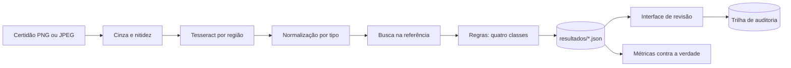

# OCR2Act

[](https://github.com/Fontoura21/ocr2act-go/actions/workflows/ci.yml)

O objetivo do OCR2Act é ler **certidões de nascimento originais, escritas à mão há décadas**, como as do registro civil de Santa Catarina entre 1850 e 1999, e transformá-las em dados conferidos. O sistema lê cada campo por OCR, pré-preenche o formulário e compara o valor lido com uma fonte de referência. Cada campo cai em uma de quatro classes: *compatível*, *provável erro de OCR*, *divergência real* ou *revisão necessária*. Nenhum campo crítico é confirmado sem ação humana, e cada ação do revisor entra numa trilha de auditoria encadeada por hash.

Para medir o pipeline com a verdade conhecida campo a campo, esta etapa usa certidões sintéticas. A leitura de manuscritos está em avaliação.

O sistema é feito em Go. O protótipo e a avaliação dos modelos de OCR e de reconhecimento de manuscritos (HTR) foram feitos em Python, e o conjunto sintético vem do gerador do protótipo. Projeto da disciplina INE5448 (UFSC).

## Resultados

### Pipeline (certidões sintéticas)

São 30 registros em três níveis de degradação: 90 certidões e 990 campos. Medições num Apple M2 de 8 núcleos com Tesseract 5.5.3; os tempos são a mediana de três execuções.

| | |
|---|---|
| Tempo para processar as 90 certidões | 14,5 s com 8 workers; 62,6 s com 1 |
| Falso compatível crítico (meta: zero) | 0 |
| Decisões aceitáveis | 100% |
| Revocação de divergência real (avaliação) | 0,815 |
| CER na avaliação (forte / leve / limpa) | 0,23% / 0,10% / 0,07% |

O tempo é dominado pelo Tesseract. O ganho de 4,3× vem de ler vários documentos ao mesmo tempo com um worker pool de goroutines.

### Manuscritos (protótipo em Python)

Avaliação no conjunto de validação do TraPrInq: 30 páginas e 827 linhas de manuscritos em português dos séculos XVI a XIX.

| Motor | CER |
|---|---|
| Tesseract 5.5.3 (português) | 89,1% |
| Kraken com o modelo TraPrInq | 4,3% |

O Tesseract, feito para texto impresso, praticamente não lê manuscritos, enquanto um modelo treinado para manuscritos históricos erra 4,3% dos caracteres. O modelo TraPrInq é de Weslley Oliveira e está publicado no Zenodo.

Nas primeiras 36 certidões originais testadas (FamilySearch, 1930 a 1998), os dois motores ainda recuperam poucos campos: 3,9%. Fazer a leitura de manuscritos funcionar nessas certidões é o próximo passo.

### Validação contra o protótipo em Python

`ocr2act comparar` compara dois conjuntos de resultados campo a campo:

| Certidões | Campos | Texto idêntico | Decisão idêntica |
|---|---|---|---|
| 30 PNG (limpas) | 330 | 330 | 330 |
| 60 JPEG (degradadas) | 660 | 655 | 656 |
| **Total** | **990** | **985 (99,5%)** | **986 (99,6%)** |

Nas PNG o resultado é idêntico, inclusive a confiança: o recorte em cinza tem os mesmos bytes que o do protótipo, então o Tesseract recebe a mesma imagem. As diferenças vêm da decodificação de JPEG. A IDCT do `image/jpeg` arredonda diferente da do libjpeg-turbo usado pelo Pillow, e a luminância difere em ±1 em cerca de 0,5% dos pixels. Isso muda a confiança de 167 dos 660 campos JPEG, em 126 deles por 0,01. Em 4 campos a decisão muda: em três a confiança cruza o limiar de 0,90 e em um o texto lido é outro. No recorte de avaliação as duas mudanças se compensam e as métricas ficam iguais.

Também verificado:

- calculadas sobre os resultados do protótipo, as métricas desta implementação reproduzem o `metricas.json` original;
- a trilha de auditoria grava as mesmas linhas, byte a byte, e cada implementação verifica a trilha da outra;
- no mesmo computador, o protótipo leva 63,6 s para processar as 90 certidões.

## Como rodar

Requisitos: Go 1.27 e Tesseract 5 (`brew install tesseract` ou `apt install tesseract-ocr`). O modelo de português (tessdata_fast) já está no repositório.

```bash
make processar   # lê as 90 certidões de data/docs e grava data/resultados
make metricas    # mede as decisões contra a verdade de referência
make servir      # interface de revisão em http://localhost:8000
make test        # testes, com o detector de corridas
make lint        # gofmt, go vet e staticcheck
```

A CLI:

```text
ocr2act processar [-workers N] [-referencia URL] [doc_id ...]
ocr2act metricas
ocr2act auditoria
ocr2act comparar <resultados_a> <resultados_b>
ocr2act servir [-addr :8000]
```

Com `-referencia`, o pipeline consulta a API de referência por HTTP em vez da base local.

### Docker

```bash
docker build -t ocr2act .
docker run --rm -p 8000:8000 ocr2act              # processa o conjunto e sobe a interface

docker build --target referencia -t ocr2act-referencia .
docker run --rm -p 8080:8080 ocr2act-referencia   # só a API de referência
```

A imagem de referência tem só o binário estático e a base, sem shell nem gerenciador de pacotes, e ocupa 22 MB. O serviço escuta em `:$PORT`, desliga de forma graciosa no `SIGTERM` e grava logs em JSON com as chaves do Cloud Logging, então segue o contrato do Cloud Run.

## Arquitetura



| Pacote | Papel |
|---|---|
| `cmd/ocr2act` | CLI: processamento, métricas, auditoria, comparação e interface |
| `cmd/referencia` | API de referência como serviço independente |
| `internal/pipeline` | Processamento de ponta a ponta e worker pool de goroutines |
| `internal/ocr` | Tesseract por região, conversão para cinza e nitidez |
| `internal/rules` | Classificação: DV e mapa de confusão nos identificadores, tokens e chave fonética nos nomes, datas sem DV |
| `internal/normalize` | Normalização por tipo de campo, com a lista de transformações aplicadas |
| `internal/reference` | Base SQLite, API HTTP no contrato do Mini-CIC, cliente HTTP e especificação OpenAPI |
| `internal/metrics` | CER, acurácia por campo, matriz de confusão e falso compatível crítico |
| `internal/audit` | Trilha JSONL encadeada por hash e verificador |
| `internal/web` | Interface de revisão humana |
| `internal/parity` | Comparação de dois conjuntos de resultados |
| `config/regras.yaml` | Limiares e mapa de confusão, fora do código |

Decisões de projeto:

- **Concorrência.** Um worker pool lê vários documentos ao mesmo tempo, com cancelamento por contexto. Cada região é lida por um processo do Tesseract: não há cgo nem estado compartilhado entre leituras. A imagem vai pela entrada padrão e o TSV volta pela saída padrão, sem arquivos temporários.
- **Binários estáticos.** O SQLite é o `modernc.org/sqlite`, escrito em Go, então os binários não dependem de bibliotecas do sistema e a imagem do serviço de referência é distroless.
- **Resultados comparáveis com o protótipo.** A conversão para cinza usa a mesma conta inteira do Pillow, as regiões arredondam meio para par como o `round` do Python, a confiança é truncada como no pytesseract e a normalização segue as regras de maiúsculas e de espaço em branco do Python.
- **Segurança da interface.** CSP restritiva, proteção contra CSRF com `http.CrossOriginProtection`, identificadores validados antes de qualquer acesso a disco e erros internos só no log.

## API de referência

| Método | Rota | Resposta |
|---|---|---|
| GET | `/ref/registros/matricula/{matricula}` | 200 com o registro, 404 se não houver |
| GET | `/ref/registros/cpf/{cpf}` | 200 com o registro, 404 se não houver ou se houver mais de um |
| GET | `/openapi.yaml` | especificação OpenAPI 3.1 |
| GET | `/healthz` | `ok` |

Não existe busca por nome, para evitar enumeração de pessoas.

```bash
curl localhost:8080/ref/registros/cpf/34131647591
```

## Conjunto de dados

Os dados deste repositório são **sintéticos** e vêm do gerador do protótipo (`python -m ocr2act.generator --n 30 --seed 42`, com Faker pt_BR). São 30 registros, cada um renderizado limpo e com degradação leve e forte. As divergências reais são plantadas alterando o valor impresso e mantendo a base. Os registros são divididos em 40% para calibração e 60% para avaliação, e a verdade de cada campo está em `data/verdade.json`.

As certidões originais do FamilySearch usadas na avaliação de manuscritos não são redistribuídas: os termos do FamilySearch proíbem, e elas ficam só na máquina local.

## Diferenças em relação ao protótipo em Python

- A decodificação de JPEG, descrita em [Validação](#validação-contra-o-protótipo-em-python).
- A nitidez usa somas inteiras exatas em vez de `float32` e pode diferir na primeira casa decimal.
- O campo `matricula_base_mascarada`, que guardava o CPF mascarado, chama-se `cpf_base_mascarado`.
- O gerador do conjunto e a leitura de manuscritos (Kraken e FamilySearch) continuam no protótipo.
- A API é documentada pela especificação OpenAPI servida em `/openapi.yaml`, no lugar do Swagger.

## Licença

MIT. O modelo `tessdata/por.traineddata` é do projeto [tessdata_fast](https://github.com/tesseract-ocr/tessdata_fast), sob a licença Apache 2.0.
